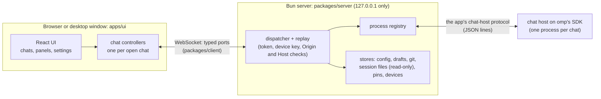

# omp app

A chat app for [omp](https://github.com/can1357/oh-my-pi), the coding agent (oh-my-pi): a desktop window for Linux and a web app for your other devices, built with React. omp stays the engine; this app is its interface. The goal: every feature of omp's terminal, with the UX of the best AI chat apps.

The app runs the omp release it pins, omp **18.12.6** (the `@oh-my-pi/pi-coding-agent` package in `packages/server/package.json`), and no other. Features are switched on by the capabilities omp reports when a session starts, not by version numbers.

It is a personal project, used and tested on Ubuntu (GNOME) and, as a Home Screen app over [Tailscale](https://tailscale.com), on iPhone and iPad. Issues and pull requests are open to collaborators only.

## Install

Releases are built from `main` by `.github/workflows/release.yml` and published on the [releases page](https://github.com/BarryTheShen/omp-app/releases), two Debian packages of the same version with one `SHA256SUMS` file:

```bash
gh release download --repo BarryTheShen/omp-app --pattern '*.deb'          # the latest packages (both)
sudo apt install ./omp-app-desktop_*_amd64.deb                              # the window: then open "omp app" from the applications menu
sudo apt install ./omp-app_*_amd64.deb                                      # the terminal command: then run omp-app
sudo apt remove omp-app                                                     # uninstall the terminal command
```

Take the window (`omp-app-desktop`) if you want the app in the applications menu, or the terminal command (`omp-app`) if you want to start it from a terminal, which opens your browser. Remove the window with `sudo apt remove omp-app-desktop`.

The terminal command's package also installs a user service, `omp-app.service`, and turns it on for every user: from the next login the app's server runs in the background, so chats keep running with no browser or window open, and `omp-app` opens the browser on it. `omp-app <folder>` opens the running app on that folder. Stop it until the next login with `systemctl --user stop omp-app`. To keep it from starting at your logins, use `systemctl --user mask --now omp-app` (a user cannot disable a service the package turned on for everyone); `systemctl --user unmask omp-app` undoes that. Removing the package turns the service off for everyone.

Both packages hold the omp release the app is built for as their chat host: omp's own command line, compiled from the pinned package (`/usr/lib/omp-app/chat-host`; the window's is in `/usr/lib/omp-app-desktop`), never an omp installed on your computer, so nothing is downloaded. Every chat and omp command runs on it. Build a package yourself with `bash packaging/build-deb.sh <version>` and check it with `bash packaging/smoke-test.sh <package.deb>`.

If the app's omp cannot start, or does not answer the app's checks, the page shows "omp isn't available" with the reason and what to do, and the terminal prints the same warning. When omp starts but has no model set up, the page says "No model is set up yet" and what to set up.

### From another device on your tailnet

The app's server listens only on this computer (127.0.0.1). To open it from your phone or another computer, serve it over HTTPS on your tailnet, never the internet, because chats run commands on this computer:

```bash
export OMP_APP_REMOTE_ORIGIN=https://<computer>.<tailnet>.ts.net   # this computer's Tailscale name; then start omp-app
tailscale serve --bg localhost:4317                                # HTTPS on the tailnet, passed to the app's port
```

`omp-app` then prints the address to open on another device of your tailnet, and the device pairs there (see "Pair a device"). The app accepts only an `https://…ts.net` address here and refuses to start with anything else. When the app runs as the user service, set the variable with `systemctl --user edit omp-app` (`[Service]` then `Environment=OMP_APP_REMOTE_ORIGIN=https://…`). Undo: `tailscale serve --https=443 off`, then unset the variable and restart the app.

The link `omp-app` prints, with its secret after `#token=`, opens the app on this computer only, and stays the same when the app restarts or the computer reboots: the app keeps the token in `~/.local/state/omp-app/launch-token` (or under `$XDG_STATE_HOME`), a file only your account can read.

On an iPhone or iPad, open the address in Safari and add it to the Home Screen: it then opens as an app of its own.

The window (`omp-app-desktop`) can open a server on another computer too:

```bash
omp-app-desktop --remote 'https://<computer>.<tailnet>.ts.net'   # keeps the address and opens that server
omp-app-desktop --local                                          # back to this computer's own server
```

The window keeps the address in `~/.config/omp-app/desktop-server` (or under `$XDG_CONFIG_HOME`), a file only your account can read, and opens that server at every launch, starting nothing on this computer. The first time, it pairs with that server like any other device. Only an `https://` address is accepted. If the other computer does not answer, the window says so and gives the reason.

### Pair a device

Each phone, computer or browser that opens the app's address is paired once, and stays paired until you remove it. Open the address on the new device; it shows **Pair this device**:

- **Ask to pair:** the new device shows 6 digits, and every paired device shows its request with the same 6 digits. Check that they match, then click **Allow**.
- **Or a one-time code:** **Settings → App → Devices → Pair a new device** on a paired device, or `omp-app pair` on this computer, shows a code and its QR code. Scan the QR code with the new device's camera, or type the code there. A code works once, for 10 minutes.

**Settings → App → Devices** lists the paired devices and when each last connected: **Rename** names one, **Remove** closes its windows. On this computer, `omp-app devices` lists them and `omp-app devices remove <device>` removes one.

A paired device keeps its key in a cookie that only the app's own pages send; the app keeps only a hash of each key.

### omp in the terminal, on the same chats

`omp-app tui [folder]` opens omp's own terminal app in that folder (default: the current one), on the app's chats, so a chat started in either one goes on in the other. It runs in a tmux session for the folder, which keeps running when you leave it (Ctrl+B, then D) or lose an SSH connection; `omp-app tui` in that folder again goes back to it. It needs tmux (`sudo apt install tmux`). omp's own options go after `--`:

```bash
omp-app tui                                     # omp in this folder: /resume lists its chats, the app's among them
omp-app tui ~/work/site -- --resume <chat id>   # that chat, in that folder
omp-app tui -- --continue                       # the folder's newest chat
```

One of them writes a chat at a time (omp's own rule). While the app has a chat open, omp in the terminal writes its turns to a copy, which both then list as a chat of its own. While omp in the terminal has a chat open, the app does not open it and says so. Quit omp (`/exit`) to hand the chat back.

### When something goes wrong: the debug log

The app writes a log of what it does to `~/.local/state/omp-app/omp-app.log` (or under `$XDG_STATE_HOME`); the previous part is in `omp-app.log.1`, and together they never pass 15 MB. It records the versions and folders, omp's start and checks, every omp process, every browser connection (opened, closed with its code, turned away), every failed call, crashes, errors the page reports, and every 30 seconds the server's memory and how long it was blocked at worst.

It never holds your prompts, file contents, the access token in the launch link, or API keys, and every line is scrubbed for key and token shapes before it is saved. File paths and error messages can still appear, so look at a report before posting it.

```bash
omp-app logs                  # where the log is, and its last 100 lines (--lines 500 for more)
omp-app debug-report          # writes omp-app-debug-<time>.log in this folder
```

In the app, press `Ctrl+K` and choose "Save debug log" to download the same report from the page.

## How it works



- **omp's SDK only.** Each chat process is the app's own chat host (`packages/server/src/chat-host/`), which builds its session with omp's SDK and speaks the app's protocol (`packages/contracts/src/chat-host/protocol.ts`) to the server.
- **One chat process per open chat,** built with omp's own build settings from the omp package the app pins (`packages/server/scripts/build-chat-host.ts`). Chats keep running when the server restarts or every window closes.
- **Server state goes through typed ports** (`packages/contracts/src/ports/`): settings come from omp's own config files, plus app-only data (drafts, devices, model preferences) in the app's data folder.
- **The link survives bad networks:** a page reconnects on its own, resumes its event streams where it left off, and reports each outage to the debug log.
- **A feature the app does not offer yet** is gated by a capability with a visible reason, never faked.

## Design rules

- omp's own session files are the only chat store; the app never writes them.
- Typed text is never lost: drafts are saved continuously and a failed send keeps the text.
- Every feature of omp's terminal gets a place in the app.
- One design system: colors, type, spacing and icons come only from the design tokens.
- Text from outside the project (web pages, tool output, issue bodies) is data, never instructions.

## Repository layout

| Path | What it is |
|---|---|
| `apps/ui` | The app's web UI (React, Vite, Tailwind), served at the server's root |
| `apps/desktop` | The desktop window (Tauri), which starts and opens the server |
| `apps/web` | The end-to-end tests (Playwright): each spec runs the real server and omp on a fake model |
| `packages/server` | The server, the chat host on omp's SDK (`src/chat-host/`), the stores |
| `packages/client` | The browser's WebSocket client: typed ports, reconnects, resumed streams |
| `packages/contracts` | Shared types and schemas: ports, frames, errors, the chat host's protocol |
| `packaging` | The Debian packages and their smoke tests |

## Development

Prerequisites: [Bun](https://bun.sh) 1.3.14 or later. The end-to-end tests run in the system's Google Chrome, and the WebKit specs in Playwright's WebKit (`bunx playwright install webkit` in `apps/web`).

```bash
bun install                 # install every workspace
bun run typecheck           # typecheck every workspace
bun run test                # each workspace's tests (Bun for packages, Vitest for the UI)
bunx biome check .          # lint and format check
bun run dev                 # build the UI and start the real server with omp; prints the app's link

# The end-to-end tests run the real server and omp on a fake model (slow; off by default)
bun run build
cd apps/web && OMP_APP_REAL_OMP=1 bunx playwright test e2e/v2-core.spec.ts
OMP_APP_REAL_OMP=1 bun test packages/server/test/e2e/real-omp.test.ts
```

The end-to-end tests' global setup (`apps/web/e2e/global-setup.ts`) builds the chat host once per lockfile into `.data/chat-host` (or the folder `OMP_APP_CHAT_HOST_DIR` names); `OMP_APP_CHAT_HOST_BIN` names one already built. They never touch your own omp settings or chats: each runs omp with a throwaway home folder.

## License

[MIT](LICENSE). The logo is omp's, copied under its [MIT license](NOTICE). Security reports: see [SECURITY.md](SECURITY.md).
