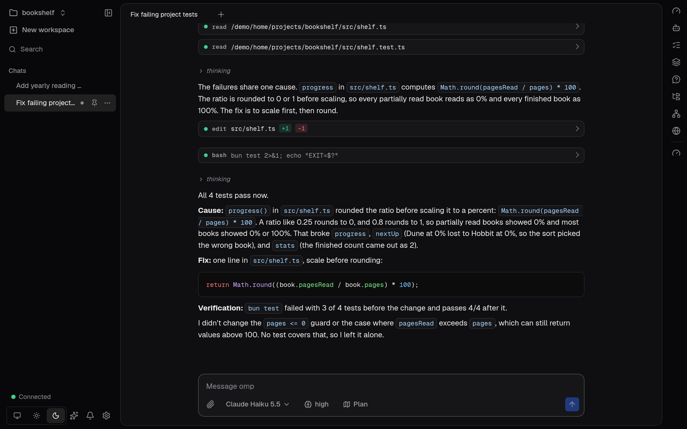
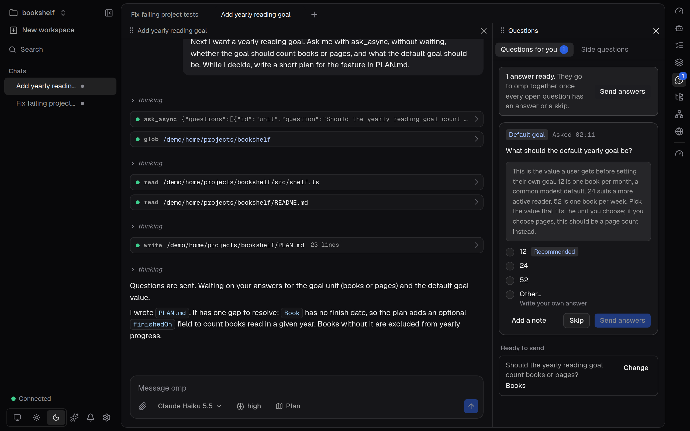
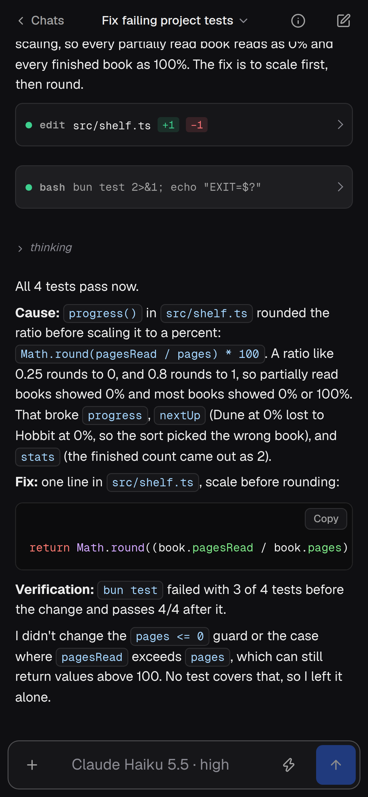

# omp app

A chat app for [omp](https://github.com/can1357/oh-my-pi), the coding agent: a desktop window for Linux and a web app for your other devices. omp stays the engine; this app is its interface.



## What it does

- **Workspaces of chats.** Chats open in tabs, and each tab splits into windows that you arrange by dragging. Closing a window leaves its chat running.
- **A message box that speaks omp.** `/` lists omp's commands, `@` mentions a file, `!` runs a shell command and `$` runs Python. Attach pictures and files, and while omp works, steer it, queue a follow-up, pause it or stop it.
- **Models and roles.** A model menu with Favorites, Recent and each provider's models, a thinking-level menu, and omp's roles, each with its own model.
- **Plan mode.** omp plans first and changes nothing until you approve the plan.
- **A Questions panel.** When omp asks something it does not need answered at once, the question waits there while omp keeps working. Your answers wait too, and go to omp together as one message, when you send them or once every question has one.
- **A side panel** beside your chats: Usage, Agents (open the Agent Hub for a subagent's live log), Progress (goal, to-do list, plan mode), Jobs, Files, Ports and Browser.
- **A browser for chats.** Choose the browser they use: omp's hidden one, a Chrome on the app's computer shown live in the panel, or your own browser through omp's relay.
- **Usage limits.** See your accounts' usage and pace on the dashboard. Rules pause the chats you pick while a condition holds and continue them in turn afterwards, and a chat that a limit stopped continues by itself once the limit resets.
- **Phone and iPad.** A layout for phones and touch screens, which you can add to the Home Screen of an iPhone or iPad.
- **Your other devices,** at an HTTPS address that you serve the app at (Tailscale Serve, a reverse proxy, a tunnel). The server listens on this computer only; each device pairs once with a code or by being allowed from a paired device.
- **omp in the terminal on the same chats.** `omp-app tui` opens omp's own terminal app on the app's chats, so you can go on in either.
- **Guided tours and What's new.** Click-through tours of the basics, and a list of every update with the tours it brought.

<table>
  <tr>
    <td></td>
    <td width="27%"></td>
  </tr>
  <tr>
    <td>omp's questions wait in the Questions panel while it keeps working; your answers go to it together.</td>
    <td>The phone layout, as a Home Screen app.</td>
  </tr>
</table>

The screenshots show a made-up project, with omp on Claude Haiku 5.5.

## Install

Releases are published on the [releases page](https://github.com/BarryTheShen/omp-app/releases) as two Debian packages of the same version, with one `SHA256SUMS` file:

```bash
gh release download --repo BarryTheShen/omp-app --pattern '*.deb' --pattern SHA256SUMS   # both packages and their checksums
sha256sum -c --ignore-missing SHA256SUMS                                                   # each file must say OK
sudo apt install ./omp-app-desktop_*_amd64.deb   # the window: then open "omp app" from the applications menu
sudo apt install ./omp-app_*_amd64.deb           # the terminal command: then run omp-app
```

Both packages hold the omp release the app is built for, so omp needs no separate install. [docs/install.md](docs/install.md) covers requirements, the user service, updating and removing.

Each release also carries the extensions that show the app's chat in other apps ([docs/integrations.md](docs/integrations.md)): `omp-app-zen_*` for Firefox and Zen ([apps/zen](apps/zen/README.md)), and `omp-app-vscode_*.vsix` for VS Code ([apps/vscode](apps/vscode/README.md)).

## Documentation

| Page | What it covers |
|---|---|
| [docs/install.md](docs/install.md) | Requirements, installing, the user service, updating, uninstalling, and where the app keeps its files. |
| [docs/devices.md](docs/devices.md) | Opening the app from a phone or another computer, pairing, the iPhone and iPad Home Screen app, and shared ports. |
| [docs/using.md](docs/using.md) | Every part of the app, and its keys. |
| [docs/configuration.md](docs/configuration.md) | Commands and flags, environment variables, folders and files, and the omp settings the app uses. |
| [docs/troubleshooting.md](docs/troubleshooting.md) | What each message means and what to do, and the debug log. |
| [docs/README.md](docs/README.md) | The index of all the documentation. |
| [docs/architecture.md](docs/architecture.md) | How the app is put together. |
| [docs/development.md](docs/development.md) | Running and changing the code. |
| [docs/testing.md](docs/testing.md) | The tests and how to run them. |
| [docs/releasing.md](docs/releasing.md) | How releases are built and published. |
| [CONTRIBUTING.md](CONTRIBUTING.md) | Who can contribute, and the checks a change must pass. |
| [SECURITY.md](SECURITY.md) | What the app guards, and how to report a vulnerability. |
| [packages/server](packages/server/README.md), [packages/client](packages/client/README.md), [packages/contracts](packages/contracts/README.md), [apps/ui](apps/ui/README.md), [apps/desktop](apps/desktop/README.md), [apps/web](apps/web/README.md) | One short page for each part of the code. |

## Project status

The app runs the omp release it pins, omp **18.12.6** (the `@oh-my-pi/pi-coding-agent` package in [`packages/server/package.json`](packages/server/package.json)), and no other. Features are switched on by the capabilities omp reports when a session starts, not by version numbers.

It is a personal project, used and tested on Ubuntu (GNOME) and, as a Home Screen app over [Tailscale](https://tailscale.com), on iPhone and iPad. Issues and pull requests are open to collaborators only. Report a security problem through [SECURITY.md](SECURITY.md), not in an issue.

## License

[MIT](LICENSE). The logo is omp's, copied under its [MIT license](NOTICE). Security reports: see [SECURITY.md](SECURITY.md).
