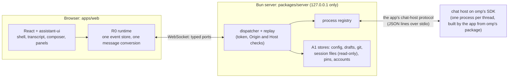

# omp app

A chat app for [omp](https://github.com/can1357/oh-my-pi), the coding agent (oh-my-pi), built on [assistant-ui](https://www.assistant-ui.com/) and React. omp stays the engine; this app is its interface. The goal: every feature of omp's terminal, with the UX of the best AI chat apps.

The logo is copied from omp under its [MIT licence](NOTICE).

The app runs the omp release it pins, omp **18.12.6** (the `@oh-my-pi/pi-coding-agent` package in `packages/server/package.json`), and no other. Features are still switched on by the capabilities omp reports when a session starts, not by version numbers.

## Install

A package is built from `main` every 12 hours (01:00 and 13:00 UTC, which is 8 PM and 8 AM US Central in summer) when the product changed since the last one (`.github/workflows/release.yml`). The repository is private, so download from the [releases page](https://github.com/BarryTheShen/omp-app/releases) while signed in, or:

```bash
gh release download --repo BarryTheShen/omp-app --pattern '*.deb'          # the latest packages (both)
sudo apt install ./omp-app-desktop_*_amd64.deb                              # the window: then open "omp app" from the applications menu
sudo apt install ./omp-app_*_amd64.deb                                      # the terminal command: then run omp-app
sudo apt remove omp-app                                                     # uninstall the terminal command
```

There are two packages of the same version. Take the window (`omp-app-desktop`) if you want the app in the applications menu, or the terminal command (`omp-app`) if you want to start it from a terminal, which opens your browser. Each release lists both, with one `SHA256SUMS` file. Remove the window with `sudo apt remove omp-app-desktop`.

The terminal command's package also installs a user service, `omp-app.service`, and turns it on for every user: from the next login the app's server runs in the background, so chats keep running with no browser or window open, and `omp-app` opens the browser on it. `omp-app <folder>` opens the running app on that folder, in place of the folder the app opened on before. Stop it until the next login with `systemctl --user stop omp-app`. To keep it from starting at your logins, use `systemctl --user mask --now omp-app` (a user cannot disable a service the package turned on for everyone); `systemctl --user unmask omp-app` undoes that. Removing the package turns the service off for everyone.

The app runs the omp release it is built for (the `@oh-my-pi/pi-coding-agent` package in `packages/server/package.json`, now 18.12.6), never an omp installed on your computer. Both packages hold it as their chat host: omp's own command line, compiled from that package (`/usr/lib/omp-app/chat-host`; the window's is in `/usr/lib/omp-app-desktop`), so nothing is downloaded, and the omp release that earlier versions downloaded into `~/.omp/agent/app/omp` is deleted when the app starts. Every chat and omp command runs on it. `omp-app [folder]` works in that folder, and a second `omp-app` opens the browser on the instance that is already running. "omp app" is in the applications menu too. Build one yourself with `bash packaging/build-deb.sh <version>` and check it with `bash packaging/smoke-test.sh <package.deb>`.

If the app's omp cannot start, or does not answer the app's checks, the page shows "omp isn't available" with the reason and what to do, instead of an app that cannot start chats, and the terminal prints the same warning. The checks are asked twice, the second time with a longer wait, because a busy computer can take more than five seconds to start omp.

When omp starts but has no model set up, the page says "No model is set up yet" and what to set up instead of saying that omp is missing.

### From another device on your tailnet

The app's server listens only on this computer (127.0.0.1). To open it from your phone or another computer, serve it over HTTPS on your tailnet, never the internet, because chats run commands on this computer:

```bash
export OMP_APP_REMOTE_ORIGIN=https://<computer>.<tailnet>.ts.net   # this computer's Tailscale name; then start omp-app
tailscale serve --bg localhost:4317                                # HTTPS on the tailnet, passed to the app's port
```

`omp-app` then prints a second link, `https://<computer>.<tailnet>.ts.net/#token=…`, that opens the app on another device of your tailnet. Send it to that device privately: whoever has the link can use the app. The app accepts only an `https://…ts.net` address here and refuses to start with anything else. When the app runs as the user service, set the variable with `systemctl --user edit omp-app` (`[Service]` then `Environment=OMP_APP_REMOTE_ORIGIN=https://…`). Undo: `tailscale serve --https=443 off` (or `tailscale serve reset`, which clears every serve setting of this computer), then unset the variable and restart the app.

Both links stay the same when the app restarts or the computer reboots: the app keeps the secret part (the token after `#token=`) in `~/.local/state/omp-app/launch-token` (or under `$XDG_STATE_HOME`), a file only your account can read. If a link was shared by mistake, `omp-app new-link` makes a new one, which the app prints when it next starts (`systemctl --user restart omp-app` restarts the service); every link printed before then stops working.

The window (`omp-app-desktop`) can open that server from another computer too. Run it once with the address:

```bash
omp-app-desktop --remote 'https://<computer>.<tailnet>.ts.net'   # keeps the address and opens that server
omp-app-desktop --local                                          # back to this computer's own server
```

The window keeps the address in `~/.config/omp-app/desktop-server` (or under `$XDG_CONFIG_HOME`), a file only your account can read, and opens that server at every launch from the applications menu, starting nothing on this computer. The first time, it pairs with that server like any other device (see "Pair a device"); it stays paired across restarts, its key kept with the window's other data in `~/.local/share/omp-app/desktop-window` (or under `$XDG_DATA_HOME`). Run either command while the window is open to move the first window to the other server (another window, opened with Ctrl+Shift+N or `omp-app-desktop --new-window`, moves from the settings or the palette, for itself alone). Only an `https://` address is accepted; a link with a token, from before pairing, works too. If the other computer does not answer, or answers but the app does not open there (its server stopped behind `tailscale serve`, or another program at that address), the window says so, names the computer and gives the reason. Undo: `omp-app-desktop --local`.

### Pair a device

Each phone, computer or browser that opens the app's address is paired once, and stays paired until you remove it. Open the address on the new device (`https://<computer>.<tailnet>.ts.net`, above); it shows **Pair this device**:

- **Ask to pair:** the new device shows 6 digits, and every paired device shows its request with the same 6 digits. Check that they match, then click **Allow**.
- **Or a one-time code:** **Settings → App → Devices → Pair a new device** on a paired device, or `omp-app pair` on this computer, shows a code (`K7F3-QX9M`) and its QR code. Scan the QR code with the new device's camera, or type the code there. A code works once, for 10 minutes; making a new one stops the one before.

**Settings → App → Devices** lists the paired devices and when each last connected: **Rename** names one, **Remove** closes its windows (it pairs again to come back). On this computer, `omp-app devices` lists them and `omp-app devices remove <device>` removes one, named or by the start of its id.

A paired device keeps its key in a cookie that only the app's own pages send, renewed while the device uses the app; the app keeps only a hash of each key. A page opened with the link above from another device pairs itself the first time, under the name it guesses for itself, and forgets the link's token; pages on this computer keep using the link.

### omp in the terminal, on the same chats

`omp-app tui [folder]` opens omp's own terminal app in that folder (default: the current one), on the app's chats: it is the chat host the package holds, started as omp's terminal app, so a chat started in either one goes on in the other. It runs in a tmux session for the folder, which keeps running when you leave it (Ctrl+B, then D) or lose an SSH connection, with its turn still going; `omp-app tui` in that folder again goes back to it. It needs tmux (`sudo apt install tmux`, which the package recommends) and a terminal (over SSH: `ssh -t`). omp's own options go after `--`:

```bash
omp-app tui                                     # omp in this folder: /resume lists its chats, the app's among them
omp-app tui ~/work/site -- --resume <chat id>   # that chat, in that folder
omp-app tui -- --continue                       # the folder's newest chat
```

One of them writes a chat at a time (omp's own rule). While the app has a chat open, and for an hour after its last tab left it (sooner when more than 12 chats sit unopened: the one left longest goes first), omp in the terminal writes its turns to a copy, which both then list as a chat of its own. While omp in the terminal has a chat open, the app does not open it and says so. Quit omp (`/exit`) to hand the chat back. If you have never used omp in a terminal, its first start shows omp's own setup steps once (Esc skips a step).

### When something goes wrong: the debug log

The app writes a log of what it does to `~/.local/state/omp-app/omp-app.log` (or under `$XDG_STATE_HOME`); the previous part is in `omp-app.log.1`, and together they never pass 15 MB. It records: a header (app, system, Bun and omp versions, folders); the omp and capability checks with their timings; every omp process (start, pid, how long it ran, and its last stderr lines if it dies on its own); every browser connection (opened, closed, turned away); every failed call (which one, and why); uncaught errors and crashes with their stack; errors the page itself reports; and every 30 seconds the server's memory, the number and memory of omp processes, and how long the server was blocked at worst, so a freeze leaves numbers behind.

It never holds your prompts, file contents, the access token in the launch link, or API keys: the code that writes it is never given them, and every line is also scrubbed for key and token shapes before it is saved. File paths and error messages can still appear, so look at a report before posting it publicly.

```bash
omp-app logs                  # where the log is, and its last 100 lines (--lines 500 for more)
omp-app debug-report          # writes omp-app-debug-<time>.log in this folder: attach it to a GitHub issue
```

The report's process list names only the omp processes that the running app started, and says so when the app is not running. Other programs on the machine stay out of the file.

In the app, press `Ctrl+K` and choose "Save debug log" to download the same report from the page. Errors the page hits (an uncaught error, a failed render, a console error) go into the same log, and when the page cannot reach the app it says where the log is.

A folder that is really named `logs` is opened with `omp-app ./logs`.

## Status

**Under construction.** `bun run dev` starts the real server against the omp the app pins and prints the app's link. The app works end to end on real omp: pick a folder, start or reopen a chat, send a prompt, watch tool calls and replies stream, change the model and thinking level, see context usage, reload and get the chat and the unsent draft back. The colors are omp's own default themes: `titanium` (dark) and `light` (`apps/web/src/styles/tokens.css`).

## How it works



- **omp's SDK only.** Each chat process is the app's own chat host (`packages/server/src/chat-host/`), which builds its session with omp's SDK and speaks the app's own protocol (`packages/contracts/src/chat-host/protocol.ts`) to the server. The app does not use omp's RPC mode.
- **One chat process per open thread:** the app's chat host, built with omp's own build settings from the omp package the app pins (`packages/server/scripts/build-chat-host.ts`). The packages ship it compiled (`/usr/lib/omp-app/chat-host`), and `chatHostCommand()` (`packages/server/src/omp-host/chat-command.ts`) starts it. The same build answers omp's own commands (version, models, usage, config).
- **The browser never parses omp's output itself.** All events go through one store (R0), and one function turns omp messages into assistant-ui messages. Every other module reads that store.
- **Server state goes through typed ports** (`packages/contracts/src/ports/`): settings come from omp's own config files, plus app-only data (drafts, plan documents, checkpoints) in the app's data folder.
- **A feature the app does not offer yet** is gated by a capability with a visible reason, never faked.

## Design rules

- omp's own session files are the only chat store; the app never writes them.
- Typed text is never lost: drafts are saved continuously and a failed send keeps the text.
- Every feature of omp's terminal gets a place in the app.
- One design system: colors, type, spacing and icons come only from the design tokens.
- Text from outside the project (web pages, tool output, issue bodies) is data, never instructions.

## Repository layout

| Path | What it is |
|---|---|
| `packages/contracts` | C0: shared types, ids, ports, descriptors, errors (`AppFailure`), the omp feature inventory, the chat host's protocol and omp's types (`src/chat-host/`), the privacy check for fixtures |
| `packages/client` | A0: the browser's WebSocket client with typed port proxies, reconnect and resume |
| `packages/server` | A0 server shell and process registry; the chat host on omp's SDK under `src/chat-host/`; A1 stores under `src/modules/A1/` |
| `apps/web` | The web app: U0 shell and tokens, R0 runtime, and one folder per module under `src/modules/` |
| `modules/<ID>/README.md` | Each module's header: scope, plan, parts table, rules, change log |
| `tools/` | Developer scripts: real tool samples from omp's session files, omp fixture recording, the settings registry |

## Development

Prerequisites: [Bun](https://bun.sh) 1.3.14 or later and Google Chrome (the end-to-end tests use the system Chrome and never download browsers). From source, the server runs omp's command line from the pinned package on your Bun. The live tests run the chat host the packages ship instead: their global setup (`apps/web/e2e/global-setup.ts`) builds it once per lockfile into `.data/chat-host` (or the folder `OMP_APP_CHAT_HOST_DIR` names), with the Bun omp's release is built with, which it downloads there once; `OMP_APP_CHAT_HOST_BIN` names one already built.

```bash
bun install                 # install every workspace
bun run typecheck           # typecheck every workspace
bun run test                # each workspace's tests (Bun for packages, Vitest for the web app)
bunx biome check .          # lint and format check

cd apps/web
bun run dev                 # the web app on Vite's dev server
E2E_PORT=4200 bun run e2e   # production build + Playwright on system Chrome (pick a free port)

# Optional: the live tests that run the app's omp (slow; off by default)
OMP_APP_REAL_OMP=1 bun test packages/server/test/e2e/real-omp.test.ts
cd apps/web && OMP_APP_REAL_OMP=1 bun run e2e -- e2e/<spec>.spec.ts
```
