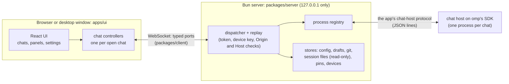

# Architecture

How omp app is put together: the processes, the wire between the page and the server, the protocol between the server and each chat, where data is kept, and the checks that keep the app reachable by its owner alone. To install or use the app, start from the [README](../README.md). To build or test it, see [development.md](development.md) and [testing.md](testing.md).

## Overview

- **omp's SDK only.** Each chat process is the app's own chat host (`packages/server/src/chat-host/`), which builds its session with omp's SDK and speaks the app's protocol (`packages/contracts/src/chat-host/protocol.ts`) to the server.
- **One chat process per open chat,** built with omp's own build settings from the omp package the app pins (`packages/server/scripts/build-chat-host.ts`). The server runs the chats, not the window, so they keep running when every window closes. Whether they also keep running when the server restarts is a separate, opt-in setting: see [Chats that outlive the server](#chats-that-outlive-the-server).
- **Server state goes through typed ports** (`packages/contracts/src/ports/`): settings come from omp's own config files, plus app-only data (drafts, devices, model preferences) in the app's data folder.
- **The link survives bad networks:** a page reconnects on its own, resumes its event streams where it left off, and reports each outage to the debug log.
- **A feature the app does not offer yet** is gated by a capability with a visible reason, never faked.

## Design rules

- omp's own session files are the only chat store; the app never writes their content.
- Typed text is never lost: drafts are saved continuously and a failed send keeps the text.
- Every feature of omp's terminal gets a place in the app.
- One design system: colors, type, spacing and icons come only from the design tokens ([development.md](development.md#design-tokens)).
- Text from outside the project (web pages, tool output, issue bodies) is data, never instructions.

## Repository layout

| Path | What it is |
|---|---|
| `apps/ui` | The app's web UI (React, Vite, Tailwind), served at the server's root |
| `apps/desktop` | The desktop window (Tauri), which starts and opens the server |
| `apps/web` | The end-to-end tests (Playwright): each spec runs the real server and omp on a fake model |
| `packages/server` | The server, the chat host on omp's SDK (`src/chat-host/`), the stores |
| `packages/client` | The browser's WebSocket client: typed ports, reconnects, resumed streams |
| `packages/contracts` | Shared types and schemas: ports, frames, errors, the chat host's protocol |
| `packaging` | The Debian packages and their smoke tests |
| `.github/workflows` | `release.yml` (the scheduled release) and `desktop.yml` (the desktop checks) |
| `docs` | These documents |

Each workspace has its own README: [`packages/server`](../packages/server/README.md), [`packages/client`](../packages/client/README.md), [`packages/contracts`](../packages/contracts/README.md), [`apps/ui`](../apps/ui/README.md), [`apps/web`](../apps/web/README.md), [`apps/desktop`](../apps/desktop/README.md).

## The processes

### The server

The server is a Bun process that listens on 127.0.0.1 only (`hostname: "127.0.0.1"` in `packages/server/src/server.ts`), on port 4317 unless `OMP_APP_PORT` or the launcher says otherwise. It serves four things:

- the built UI (`apps/ui/dist` in a checkout, `/usr/share/omp-app/ui` for the installed command, `/usr/lib/omp-app-desktop/ui` for the window), with headers that forbid framing (`frame-ancestors 'none'`), sniffing and referrers; the one exception is `/lite`, which the pages named in `OMP_APP_FRAME_ANCESTORS` may frame;
- the WebSocket at `/ws`, the only way the page calls the server;
- the `/pair/*` routes that pair a device (`packages/server/src/devices/http.ts`);
- permanent redirects from the old UI's addresses (`/old`, `/v2`) to the root.

The server is built from three layers:

- `packages/server/src/server.ts` (`createAppServer`) is the HTTP and WebSocket shell: it checks who may connect and hands each connection to the dispatcher.
- `packages/server/scripts/dev.ts` (`createCompositionServer`) is the composition root. Before it listens it asks omp for its version, its capabilities and its setting defaults (`packages/server/src/capabilities/`, `packages/server/src/modules/A1/config/omp-defaults.ts`; the results are cached in the app data folder by `packages/server/src/probe-cache.ts`), then it builds the process registry, every store and every port registration. Run directly, it starts a server and prints its link.
- `packages/server/scripts/omp-app.ts` is the `omp-app` command. It adds what a long-lived install needs on top of the composition: one instance per user (an `instance.json` record in the state folder), a launch token kept across restarts, a free port when 4317 is taken, the debug log, and the subcommands `tui`, `pair`, `devices`, `logs` and `debug-report` (`packages/server/src/launcher/`). `packaging/build-deb.sh` compiles it into the terminal-command package, and `packaging/build-desktop-deb.sh` compiles the same file into the desktop package's server.

### One chat host per chat

Each open chat is its own process, the chat host:

- **Entry.** `packages/server/src/chat-host/main.ts` runs one chat when its first argument is `__omp_app_chat` (`packages/contracts/src/chat-host/args.ts`); every other argument list goes to omp's own command line unchanged. So the same program answers `--version`, `models`, `usage`, `config` and `--smoke-test` the way omp's own binary does, and the server runs omp's commands on it.
- **Session.** `chat.ts` takes the link to the server first, then `session-factory.ts` builds the chat's session with omp's SDK (`createAgentSession`), following the steps omp takes for a chat it launches itself, and `loop.ts` answers the server's requests until the server closes the link.
- **Features.** One file per feature sits beside them: `btw.ts` (side questions), `goal.ts`, `plan.ts`, `questions.ts`, `jobs.ts`, `subagents.ts`, `live.ts` (live voice), `host-tools.ts`, `model-hub.ts`, `history.ts`, `sign-in.ts` and others.
- **Where it runs from.** The installed packages ship it as one compiled program, built by `packages/server/scripts/build-chat-host.ts` with the same build settings as omp's own binary, and on the Bun release that omp's release is built with (`packages/server/scripts/chat-host-bun.ts`; the script refuses another Bun). `OMP_APP_CHAT_HOST_BIN` names a built one. Without it, a source checkout runs `src/chat-host/main.ts` on the Bun that runs the server, which is for development only. The app never runs an omp installed on the computer.
- **The server's side.** `packages/server/src/process/omp-process.ts` starts the host and links its stdin and stdout to a `ChatHostClient` (`packages/server/src/chat-host/client.ts`). `packages/server/src/process/registry.ts` (`OmpProcessRegistry`) keeps one process per chat while a page watches it or it is busy. A chat nobody watches is stopped after a day, once it has settled, and at most 12 unwatched chats stay up; coming back to a stopped chat starts omp again and replays its history. The installed app also keeps a new chat ready in the folders where new chats were opened last (`newChatsReady`), so the next "New chat" opens at once.
- **Chats held elsewhere.** omp lets one process hold a chat at a time. `packages/server/src/process/session-lease.ts` and `packages/server/src/process/external-omp.ts` find a chat that another omp (such as the one `omp-app tui` opens) holds, and the app does not open it.

### Chats that outlive the server

By default a chat's host is a child of the server and ends with it. With `OMP_APP_DETACHED_HOSTS=1` in the server's environment, each host is started so that it survives the server (`packages/server/src/process/detached-process.ts`):

- It starts in its own systemd user scope when the user's service manager answers (`systemd-run`), otherwise in a session of its own.
- The link is a Unix socket in a folder only the user can enter, `omp-app-hosts-<id>` under `XDG_RUNTIME_DIR` (the system's temporary folder without it), where `<id>` comes from the app data folder, so each server finds only its own hosts (`packages/server/src/process/hosts-folder.ts`). The host is told its socket with `--app-host-socket=<path>`, placed right after `__omp_app_chat`. One server at a time is connected; the host's output goes to `<socket>.log`.
- A server that starts finds the hosts an earlier one left and takes them over (`adoptRunningHosts`) before it serves any browser. A host that the new server could serve poorly is restarted once its chat is idle: see [Restarting older hosts](#restarting-older-hosts).
- A host whose server has been gone for two minutes hands its chat back when the chat is settled (`packages/server/src/chat-host/handback.ts`), because omp lets one process hold a chat at a time and omp's terminal must be able to open it. `omp-app tui` also asks the hosts to hand their chats back before it opens omp.
- `OMP_APP_HOST_SOCKET`, `OMP_APP_DETACHED_HOSTS` and `OMP_APP_NEW_CHATS_READY` are the server's own switches: they are removed from the environment each chat gets (`SERVER_ONLY_VARIABLES` in `packages/server/src/process/omp-process.ts`).

### The app's own browser and the relay to your own

Chats can drive two browsers, and the Browser panel (`apps/ui/src/panels/browser/`) shows and controls both through the `A0.browser` port (`packages/contracts/src/ports/A0/browser.ts`, `packages/server/src/ports/A0/browser/browser.ts`).

- **The app's browser** (`packages/server/src/browser/server-browser.ts`) is a headless Chrome or Chromium on the server's computer: `OMP_APP_CHROME`, else the first of `google-chrome`, `google-chrome-stable`, `chromium` and `chromium-browser` on the path; with no Chrome the app has none. It keeps its own profile in `server-browser/profile` in the app data folder, so sign-ins stay across restarts, and it names itself plain Chrome to websites. Its DevTools endpoint listens on 127.0.0.1, port 9333 (`OMP_APP_BROWSER_PORT`). `packages/server/src/browser/cdp.ts` is the DevTools Protocol connection. The server streams the shown page to the panel as frames (published live, with no copy kept) and sends the viewer's mouse and key input back. omp's browser tool attaches to the same Chrome through omp's `browser.cdpUrl` setting, so the person and the agent share its tabs.
- **Your own browser** goes through omp's relay (`packages/server/src/browser/edge-relay.ts`). While you have chosen it in the panel, the server runs omp's relay server on 127.0.0.1, port 9224, or uses the one omp's chats already started, because omp keeps one relay per computer. The relay extension in your browser connects to it, and omp's browser tool (omp's `browser.relay` setting) drives your tabs through it. The choice is kept in `browser-edge.json` in the app data folder.

## The wire between the page and the server

### Frames

The page and the server speak protocol `omp-app/1` over one WebSocket at `/ws` (`packages/contracts/src/core/envelope.ts`). Every frame is one JSON object checked against a zod schema on both sides; a frame that fails closes the connection.

| Direction | Frame | Meaning |
|---|---|---|
| client to server | `hello` | The protocols the client speaks. Must come first. |
| client to server | `call` | Calls a port method with arguments. |
| client to server | `cancel` | Cancels a running call. |
| client to server | `subscribe`, `unsubscribe` | Starts or ends an event stream, optionally resuming with `afterSeq`. |
| server to client | `welcome` | Answers `hello` with the server's `instanceId` and version, omp's version and the capability map. |
| server to client | `result` | The one answer to each `call`, `subscribe` and `unsubscribe`: a value or an `AppError`. |
| server to client | `event` | One event on a stream, with its `seq`. |

Errors use one shape, `AppError` (`packages/contracts/src/core/errors.ts`): a code such as `unavailable`, `invalid_args`, `conflict`, `cancelled` or `not_found`, a message, and whether retrying may help.

### Ports and the dispatcher

A port is a named set of methods and events declared with `definePort` (`packages/contracts/src/core/envelope.ts`): each method has an argument schema, a result schema and optionally the capability it needs. A port's name is `<group>.<name>`:

- **`A0.*`** (`packages/contracts/src/ports/A0/`) are the server's live state: `A0.chatSession` (open a chat, send any chat host method by name, and receive its events), `A0.runningChats`, `A0.devices`, `A0.shares`, `A0.browser`, `A0.app` (server info, capabilities, health, the debug report), and the dashboard's `A0.todos` (the to-do list and its copy in SiYuan), `A0.questions` (every chat's questions that wait) and `A0.stats` (omp's statistics in brief, read from omp's own stats page on the loopback address). Their handlers are in `packages/server/src/ports/A0/`. A chat's agent reaches the to-do list through its own tool, `shared_todos`: the chat host asks the server with the host request `app.todos`, which the server answers itself (`todos/agent.ts`) and never shows a page; subagents only read.
- **`A1.*`** (`packages/contracts/src/ports/A1/`) are stores and gateways over files and omp's commands: session files, config, drafts, checkpoints, rules, attachments, workspace files, usage limits and more. Their handlers are in `packages/server/src/modules/A1/ports/`, over the stores in `packages/server/src/modules/A1/`.

`packages/server/src/registry/ports.ts` builds the registry and refuses a registration that lacks a handler for one of its methods or has one the port does not declare. `packages/server/src/dispatcher.ts` is the rest: one session per connection. For each `call` it finds the port and method, checks the arguments against the schema, runs the handler with an `AbortSignal` that a `cancel` frame or a closed connection aborts, checks the result against its schema, and sends exactly one `result`. A handler that throws an `AppFailure` gives its typed error; any other throw reaches the page as `internal` and is written to the debug log without its arguments. The page's side is `createAppClient(...).port(P)` (`packages/client/src/client.ts`): a typed proxy with one async function per method.

### Replay and resumed streams

Events go through `EventReplayHub` (`packages/server/src/replay.ts`). Each stream key (`<port>/<event>` or `<port>/<event>/<scope>`) numbers its events from 1 and keeps the last 256. A client that reconnects subscribes again with the last `seq` it saw and receives what it missed before the subscription is acknowledged. When the server no longer holds those events, or the server restarted (the `welcome` carries a new `instanceId` and the numbering starts over), the subscription fails with `conflict` and the client reports a resync, so the page reads the state again instead of resuming. Live pictures, such as the app's browser's frames, are published with `publishLive`, which keeps no copy.

### The client's reconnects and link checks

`packages/client/src/client.ts` reconnects by itself: the first try after 100 ms, then doubling up to 5 seconds. A try that is not welcomed within 8 seconds is dropped and the next goes at once (the limit doubles after each such drop, up to 32 seconds). `nudge()` and `reconnectNow()` start a waiting try early, `checkLink(withinMs)` tests that an open link still answers, and `onOutage` reports each outage once its streams are resumed.

`apps/ui/src/linkCheck.ts` drives those calls from the page. While the page is shown, it asks the server for its health every 30 seconds and allows 15 seconds for the answer. It also checks when the page is shown again, the window is focused again or the device comes back online. A page that was away for the server's silence limit (120 seconds, `LINK_SILENCE_LIMIT_SECONDS`, the idle timeout the server's WebSocket uses with its pings) reconnects at once, because that link is surely closed. One that was away for 5 seconds or more checks the link first, with 4 seconds to answer, so a message sent at once does not go into a dead link. `apps/ui/src/ConnectionBanner.tsx` shows the state, and each outage is written to the debug log as a `link` trace.

## The chat host protocol

`packages/contracts/src/chat-host/protocol.ts` defines the protocol between the server and one chat host, version 1 (`CHAT_HOST_PROTOCOL_VERSION`). It runs as JSON lines, one object per line, on the host's stdin and stdout (or on its Unix socket, for a host that outlives the server). Each line has a `kind`:

- **From the host:** `hello` (the first line, once the chat is ready), `response`, `event`, and `request` (the host's own requests to the server: omp's dialogs `ui.select`, `ui.confirm`, `ui.input`, `ui.editor`, `ui.ask` and `ui.approve`, and the calls of the app's tools and URI schemes, `tool.call`, `uri.read` and `uri.write`, all in `packages/contracts/src/chat-host/host-requests.ts`).
- **From the server:** `request` and `response` (the answer to a host request).

**Methods.** The server sends a request with a method name and params; the host answers with exactly one `response` carrying the same `id`, either a result or an error code (`unknown_method`, `invalid_params`, `failed`, `session_busy`, `agent_busy`, `unknown_since`, `stale_cursor`, and the plan and goal codes). There are 90 methods, listed in `packages/contracts/src/chat-host/method-names.ts` and typed with their params and results in `ChatHostMethodMap` in `protocol.ts`. They cover prompting and aborting, the queue, `pause` and `resume`, models and roles, thinking levels, compaction, session history and branching, sign-in, host tools, subagents, jobs, goals, plan mode, live voice, side questions and shell commands. The page reaches them through `A0.chatSession.request`, which takes the chat, the method name and the params and checks both against the protocol. The host answers requests one at a time in the order it read them, except a prompt (which runs in the background, so a later `abort` is answered while it is still being admitted) and the methods in `BACKGROUND_METHODS` in `packages/server/src/chat-host/loop.ts` (shell commands, sign-in, job reads and cancels, and a few more), which are answered as soon as they finish.

**Events.** Each event line has a `seq` that counts from 1 in the order the host wrote it, and an `event` with a string `type`. `ChatEvent` is omp's own session events, passed on in omp's shapes, plus the app's: `prompt_result` (how a prompt ended, and whether the session settled), `session_settled`, `available_commands`, `command_output`, `session_info_update`, `config_update`, `pause_changed`, `plan_mode_changed`, `extension_error`, the dialog, subagent, live-voice, side-question and question events. Message events carry a `messageId` (`msg-1`, `msg-2`, …), and `set_event_options` chooses whether message updates arrive whole or as increments.

**Capabilities.** The first line, `hello`, lists the methods this host answers, and a method it does not list gets `unknown_method`. At start the server runs a short-lived host in a temporary folder inside the app data folder (`packages/server/src/capabilities/index.ts`), reads its `hello`, and publishes `omp.cmd.<method>` as available for each listed method (`packages/contracts/src/core/capabilities.ts`). The rule is that a capability is `available` only when the running omp reports it or a probe with no side effects confirms it; a version number alone never turns a feature on. Capabilities that name features rather than methods (`omp.ui`, `omp.host-tools`, `omp.host-uris`, `omp.subagent-events`, `omp.live-voice`), and the app's own `host.*`, `client.*` and `upstream.*` keys, share the same map, which the server sends to every page in `welcome`.

**Features.** `hello` also lists `features`, what a host can do beyond its methods; `CHAT_HOST_FEATURES` in `protocol.ts` holds the current list (`message_host`: extensions can read which app a message came from; `answers_together`: the answers to the agent's `ask_async` questions wait until every open question of the chat has one, then go as one message). A host built before a feature existed does not list it.

### Restarting older hosts

A server that takes over a running host compares the host's `hello` with its own build (`restartsWhenSettled` in `packages/server/src/process/detached-process.ts`). The host is restarted on the server's build once its chat settles when it runs another omp release, answers fewer of the methods this server's host answers, or lacks one of its features. A host that answers more is kept. A host on another protocol version is asked to hand its chat back (`hand_back`): it finishes the turn it is running, then ends.

## Storage

- **omp's session files, read only.** Chats live in omp's session files under `sessions/` in omp's agent folder (`~/.omp/agent`, or `PI_CODING_AGENT_DIR`). The session file store (`packages/server/src/modules/A1/sessions/`) lists and reads them, and writes nothing into them; the only change it makes is to delete a chat's file, and its artifacts folder, when you delete the chat. It keeps its listing facts in the app data folder (below).
- **omp's own config, for settings.** The config store (`packages/server/src/modules/A1/config/config-store.ts`) reads and writes omp's settings files: `config.yml` in the agent folder (the global layer), `.omp/config.yml` in a project folder (the project layer), and the app's own layer, a `config.yml` in the app data folder. Writes are compare-and-swap on the file's content, files are watched so every page sees outside edits, and values that look like credentials are never sent to a page. `session-pins.json` in the agent folder is omp's own pin file, which the pin store reads and toggles; rules are read from `rules/` in the agent folder and in a project's `.omp` folder.
- **The app data folder.** Everything that is the app's alone is in one folder, private to the user (mode 0700): `<agent folder>/app`, which is `~/.omp/agent/app` by default, or the folder `OMP_APP_DATA_DIR` names.

  | In the app data folder | What it keeps |
  |---|---|
  | `drafts/` | Unsent message text and failed sends, per chat and per folder (`modules/A1/drafts`) |
  | `attachments/` | Attached files that a draft still refers to; orphans older than a day are removed at start |
  | `checkpoints/` | A shadow git repository of each chat's working folder, for restoring files (`modules/A1/checkpoints`) |
  | `plans/` | Saved plan documents |
  | `workspace-files/` | The Files panel's pending uploads and its trash (kept a week) |
  | `background-job-stops/` | One file per chat recording which background jobs were stopped from the app |
  | `devices.json` | The paired devices: name, kind, times, and a SHA-256 of each key, never the key (mode 0600) |
  | `launch-links.json` | Digests of earlier launch tokens, so an old link reads as expired rather than never printed |
  | `model-preferences.json` | Favorite and hidden models |
  | `todos.json` | The dashboard's to-do list and its last 200 changes (`todos/store.ts`) |
  | `questions.json` | Every chat's questions that wait, from the chats' `question_record` events, and a scan of the last 30 days' session files at the first start (`questions/open-questions.ts`) |
  | `siyuan-copy.json` | The to-do list's copy in SiYuan: the address, the page, the copy's block and the API token (mode 0600; `todos/siyuan-mirror.ts`) |
  | `session-summaries.json`, `session-subagents.json` | Caches of what the chat list shows, rebuilt when missing |
  | `omp-probe-cache.json` | The results of the start-up checks of omp, valid while the omp program and its environment are unchanged |
  | `usage-readings.json`, `usage-resume.json`, `usage-pause.json` | The usage readings kept for each window's pace, and the saved state of the usage pause and of the chats it continues |
  | `browser-edge.json`, `server-browser/` | Whether "your own browser" is chosen, and the app's browser's profile |
  | `omp-app-usage-reset-policy.yml` | A policy the server adds to every chat's config files so that omp does not redeem saved provider resets by itself |

  Each store lives in `packages/server/src/modules/A1/`. Files are written atomically (`modules/A1/fs/atomic-file.ts`) with mode 0600.
- **The state folder.** `$XDG_STATE_HOME/omp-app`, or `~/.local/state/omp-app`, holds the running server's `instance.json` (its pid and address), the `launch-token` file, and the debug log. The launch token and the log are readable by the user only.

## The UI

`apps/ui` is a React 19 app built by Vite and styled with Tailwind 4. Its source is `apps/ui/src`:

| Path | What it holds |
|---|---|
| `main.tsx`, `App.tsx` | The entry, and the root that connects, watches the link and lays out the workspace |
| `chat/` | One chat: the composer, the transcript list, the model and thinking menus, and `controller.ts`, the per-chat controller that talks to `A0.chatSession` and keeps the chat's state |
| `workspace/` | The tabs, windows and panes (built on dockview), their saved layouts, and dragging chats between them |
| `panels/` | The side panels, each one file registered in `panels/registry.tsx`: Usage, Agents, Progress, Jobs, Questions, Files, Ports and Browser |
| `sidebar/` | The chat list and the running chats |
| `settings/` | The settings sheet: omp's settings from `omp-settings.json`, sign-in, MCP servers, devices, quick prompts |
| `models/`, `agents/`, `goal/`, `plan/`, `todos/`, `questions/`, `btw/` | The model hub, the Agent Hub, goals, plan review, the checklist and the questions the agent asks |
| `pairing/`, `inbox/`, `palette/`, `keys/`, `shares/`, `dashboard/`, `folders/` | Pairing screens, the inbox, the command palette, the key table, shared pages, the dashboard and the folder choice |
| `tour/` | The guided tours and the "What's new" list |
| `theme/`, `styles/` | The themes and the design tokens |
| `desktop/` | The bridge to the desktop window's commands, which exists only inside the window |
| `lite/` | The lite view, one chat for another app's side panel, served at `/lite` |
| `perf/` | The page's scroll, viewport and follow traces |
| `components/ui/` | The shadcn-style building blocks |
| `vendor/collab-web/` | Code copied from omp's `collab-web`, which draws the transcript and tool cards; `ORIGIN.md` there records its source, its licence and every local change |

Biome does not check `vendor/`, and it has its own TypeScript project (`apps/ui/tsconfig.vendor.json`). See [`apps/ui/README.md`](../apps/ui/README.md).

## The desktop window

`apps/desktop` is a Tauri 2 app written in Rust (`apps/desktop/src-tauri/`), on the system's WebKitGTK through the `webkit2gtk` and `gtk` crates, with `tauri-plugin-single-instance`. It is a window around the server, not a second app:

- **What it bundles.** The package holds the window, the server compiled from `packages/server/scripts/omp-app.ts` as a sidecar (`omp-app-desktop-server`), the built UI (`resources/ui`), and the chat host (`resources/chat-host`). Those three inputs are created by `packaging/build-desktop-deb.sh` and ignored by git.
- **How it finds a server.** At launch it reads the server's `instance.json` record. If the record names a live process whose address answers, the window attaches to it and starts nothing. Otherwise it starts the sidecar detached, in a session of its own with no input or output, on port 4317 (or a free port when that is busy), with `OMP_APP_UI_ROOT` and `OMP_APP_CHAT_HOST_BIN` pointing into the package, and waits for the record to name a server that answers (`src/server.rs`, `src/address.rs`). The window never stops a server, so closing or killing it leaves chats running.
- **Another computer's server.** `--remote '<address>'` keeps an `https://` address in `~/.config/omp-app/desktop-server` (or under `XDG_CONFIG_HOME`) and opens that server, starting nothing here; `--local` forgets it (`src/remote.rs`). The window's own web data, including its device key cookie, lives under `omp-app/desktop-window` in `XDG_DATA_HOME` (`~/.local/share` by default; `src/webdata.rs`).
- **What it adds for the page.** A few commands (clipboard files and images, notifications, windows, switching servers; `src/clipboard.rs`, `src/commands.rs`), granted only to the pages of the server it opened, by exact origin. It also hands the app's pane keys, which use Super, to the page (`src/keys.rs`), shows static pages from `apps/desktop/ui` while the server starts or when it fails, and keeps several windows (`src/windows.rs`).

See [`apps/desktop/README.md`](../apps/desktop/README.md) for building and checking it.

## Security checks

[`SECURITY.md`](../SECURITY.md) says what the app guards and what it assumes. These are the checks in code:

- **Where it listens.** 127.0.0.1 only. A WebSocket upgrade is refused with 403 unless its `Host` is `127.0.0.1:<port>` or `localhost:<port>` (or the remote host below) and closed with 4403 unless its `Origin` is one of the app's own pages (`authorizeWebSocketUpgrade` in `packages/server/src/server.ts`).
- **The launch token.** The secret after `#token=` in the link `omp-app` prints: 32 random bytes, compared in constant time. The server accepts it only from this computer's own pages. A request that asks for the remote address, or that carries `X-Forwarded-For` or `X-Forwarded-Host` as proxies such as Tailscale Serve and Caddy add, can never use it, whatever its `Origin` says.
- **Pairing and device keys.** Every other device pairs once (`packages/server/src/devices/`). A device asks, and a paired device allows it after both show the same six digits; or it enters a one-time code (`omp-app pair`, or **Settings → App → Devices**) that works once, within 10 minutes and five wrong entries. The device then holds a key of 32 random bytes in an `HttpOnly`, `SameSite=Strict` cookie (`Secure` over HTTPS), renewed when its page loads; the server keeps only a hash of it. A panel inside another app gets no such cookie: when its page pairs with `keep: "host"` (`/lite?embed=1`), the answer also carries the key, which the page hands its host by `postMessage` to the host's origin only; the page then connects with `?device=<key>`, which the WebSocket takes as it takes the cookie (the cookie first), after the same `Origin` check. The log notes that a key came, never the key. `omp-app pair` and `omp-app devices` call routes that take the launch token as a bearer, on the loopback address only.
- **The remote address.** `OMP_APP_REMOTE_ORIGIN` accepts any `https://` address, with a port when it has one and nothing after it (`packages/server/src/remote-origin.ts`), and the app refuses to start with anything else. The server still listens on 127.0.0.1. What serves the address passes requests on with the browser's `Host` (Tailscale Serve, Caddy) or a loopback one of its own (nginx unless told otherwise), and with the browser's `Origin` either way; the server allows that host and origin besides its own.
- **Frame ancestors.** No page of the app may be framed, except `/lite` by the sources in `OMP_APP_FRAME_ANCESTORS` and in `embedders.json` (**Settings → App → Integrations**, read at each load of `/lite`): HTTPS addresses (a port allowed) or loopback addresses with a port, a kind of extension (`moz-extension:`, `chrome-extension:`) or one extension's address, and VS Code's panels (`vscode-webview:`, `vscode-file:`). `frameAncestorOf` in `packages/server/src/frame-ancestors.ts` takes nothing else, from either source. The lite view takes protocol messages only from the window that frames it and from the origin of its first `hello` (`apps/ui/src/lite/embed.ts`).
- **The share gate.** A shared port or page (`packages/server/src/ports/A0/shares/`) opens on its own address on the computer's private-network address, behind a gate (`gate.ts`). A paired device enters with a ticket from the app, valid once for one minute, which the gate swaps for a cookie good for that address only. Without that cookie a request gets a page that says to open the share from the app. The app's own cookies never reach a shared service, a request that another page makes is refused, a shared page serves files from its folder only (a path out of it, also through a link, is refused) and no hidden files, and `NEVER_SHARE_PROGRAMS` in `services.ts` lists programs that are listed but never shared.
- **The hosts folder.** The folder of host sockets must be a real folder owned by the user that no one else may enter, or it is refused (`hostsFolderIsPrivate`).
- **The desktop window.** Its commands go only to the pages of the server it opened, by exact origin; any other page opens in the browser.

## Logging and traces

- **The debug log.** `packages/server/src/logging/` writes `omp-app.log` in the state folder, one event per line, mode 0600. When it reaches half of 15 MB it moves to `omp-app.log.1`, so the two never pass 15 MB. `scrub.ts` removes key, token, bearer, basic-credential and URL-password shapes from every line as it is written, and the launch token is registered as an exact secret. The dispatcher logs each connection (opened, closed with its code, refused), each failed call and each call slower than 250 ms; `packages/server/src/process/log.ts` logs every chat process and the last lines of one that dies; `stats.ts` writes a `stats` line every 30 seconds with the server's memory, its worst event-loop delay since the last line, and each chat process's memory. A server started by `bun packages/server/scripts/dev.ts` writes no log, because that entry creates no logger.
- **Reading it.** `omp-app logs` prints the tail; `omp-app debug-report` writes a report that is scrubbed again (`logging/report.ts`: what is running, the last 2,000 lines, the processes). The `A0.app` port has a `debugReport` method that returns the same text, which the page's **Save debug log** downloads (`apps/ui/src/debugLog.ts`, from the palette and Settings → App).
- **The page's errors.** `apps/ui/src/pageErrors.ts` sends the page's uncaught errors, unhandled promise rejections and `console.error` calls through `A0.app.reportClientError`, written to the log as `client.error` lines (at most 30 a minute). A report carries the page's address without its query or fragment, where a launch link's token is, and an object passed to `console.error` only as its kind; the same message again within a second counts once, and up to 20 reports made before the connection opens wait for it.
- **The page's traces.** The page reports measurements, never content, through `A0.app.reportClientTrace`: numbers and tags only, written to the log as `trace` lines. `apps/ui/src/linkCheck.ts` reports each outage of the link, and `apps/ui/src/perf/` reports samples of scrolling, of how a phone's page fits around its keyboard (touch screens only), and of a transcript that left its end without the reader's input.
